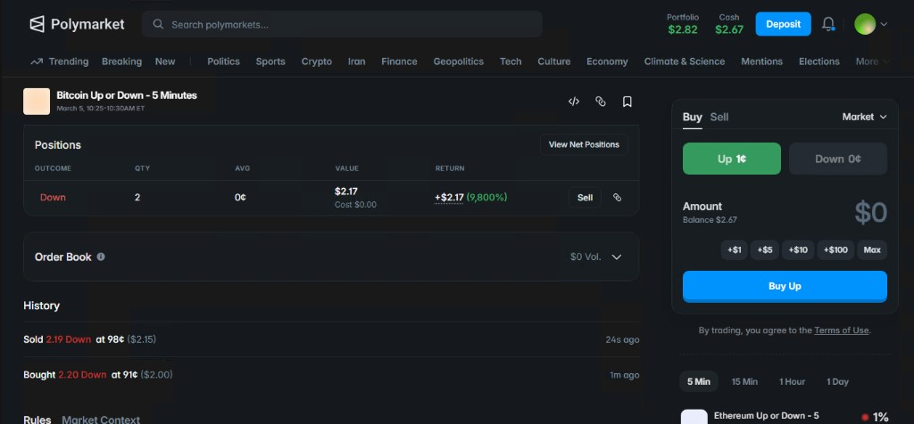
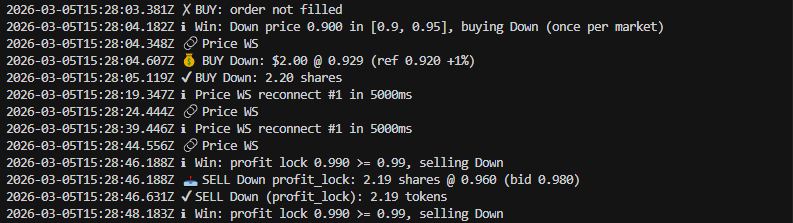
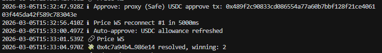

# Polymarket Arbitrage Trading Bot

Trading bot for Polymarket's "Up or Down" markets. It runs on 15-minute windows (Bitcoin, Ethereum, Solana, XRP) and uses a price prediction algorithm to place limit orders when it thinks it's got an edge. No Redis, no MongoDB — everything's stored in JSON files and plain text logs.

<p align="center">
  
</p>
## How it works

The core idea: the bot predicts whether the UP token price will move up or down, and only trades when it's confident enough (usually 50%+). When that happens, it slaps down a limit buy order at the best ask price (plus a small buffer so it actually fills).

Earnings come from getting predictions right — buying the winning side before the crowd — and holding through to resolution. You can lock in profits anytime by selling on Polymarket, or let the bot auto-redeem winning positions after markets resolve (there's a separate `auto-redeem.ts` script for that).

The predictor looks at price history, momentum, volatility, and trends. It adapts over time and tracks accuracy at each 15-minute boundary. If it's wrong a lot, it'll back off.

Example of a typical run:
- Predicts UP with 65% confidence
- Places limit buy: 5 shares @ 0.53
- Market resolves UP → correct

## What you get

- **Multi-market** — Run `btc`, `eth`, `sol`, `xrp` (or any combo) at once. Each market has its own predictor.
- **15-minute cycles** — Switches automatically at 0m, 15m, 30m, 45m. No babysitting.
- **Live prices** — WebSocket feeds, debounced so it's not spamming on every tick.
- **Accuracy tracking** — Summaries after each quarter-hour: how many predictions, correct vs wrong, costs, accuracy %.
- **Risk controls** — Max buy counts per side, minimum balance checks, market pausing when you hit limits.
- **Lightweight** — State in `src/data/copytrade-state.json`, logs to files. That's it.
- **Auto redeem** — Separate script to cash out winning positions after resolution.
- **Auto approve** — Sets up USDC allowance to Polymarket on startup.
- **Credentials** — Give it your `WALLET_PRIVATE_KEY` and it derives the CLOB API key. No manual key setup.

## Screenshots

Polymarket UI — market view, positions, selling:



Bot console — buys, WebSocket updates:



Auto redeem flow:



## How to Install

```bash
git clone https://github.com/sysnexus1/polymarket-arbitrage-bot.git
cd polymarket-arbitrage-bot
npm install
npm run dev
```

## Environment variables

Stick these in a `.env` file. Here's what matters:

**Market selection**
- `COPYTRADE_MARKETS` — Comma list: `btc`, `eth`, `sol`, `xrp` or mix like `btc,eth,sol`. Default: `btc`.

**Trading**
- `COPYTRADE_SHARES` — Shares per order (e.g. `5`)
- `COPYTRADE_PRICE_BUFFER` — Cents to add above best ask so orders fill (e.g. `0.01`). Default: `0`
- `COPYTRADE_TICK_SIZE` — Usually `0.01`
- `COPYTRADE_MAX_BUY_COUNTS_PER_SIDE` — Cap buys per side per market. `0` = no limit
- `COPYTRADE_FIRE_AND_FORGET` — Skip waiting for order confirm (faster). Default: `true`

**Credentials (required)**
- `WALLET_PRIVATE_KEY` — Your wallet's private key. The bot uses it to derive the Polymarket API key — you don't need to create one in their UI. Get it from MetaMask (Account details → Export). Don't share it.
- `SIG_TYPE` — `eoa` (default), `proxy`, or `gnosis` for Safe
- `PROXY_WALLET_ADDRESS` — If using proxy/Safe, the contract address

You don't set `POLY_API_KEY`, `POLY_PASSPHRASE`, etc. — the bot handles that.

**Bot behavior**
- `BOT_MIN_USDC_BALANCE` — Won't start below this (default: `1`)
- `BOT_MIN_RUN_BALANCE_USDC` — Stops if balance drops below (default: `50`)
- `COPYTRADE_WAIT_FOR_NEXT_MARKET_START` — Wait for next 15m boundary before trading. Default: `false`

**Optional**
- `CLOB_API_URL` — Leave default: `https://clob.polymarket.com`
- `CHAIN_ID` — 137 for Polygon
- `DEBUG` — Verbose logs
- `LOG_FILE_PATH`, `LOG_DIR`, `LOG_FILE_PREFIX` — Where logs go

Full list is in `.env.example`. For BTC 5m scripts, config is split into:
- `BTC5M_*` — common live settings shared by all BTC 5m strategies, such as market, interval, tick size, cancel timing, and BTC price refresh.
- `EDGE_*`, `HYBRID_*`, `RANGE_ARB_*`, `MM_*` — strategy-specific settings. Strategy-prefixed common vars still work as overrides, e.g. `EDGE_INTERVAL_MINUTES` overrides `BTC5M_INTERVAL_MINUTES` only for `btc5m:edge`.
- `BACKTEST_*`, `COLLECT_*` — research-only settings for local backtests and history collection.

## Switching markets

Supported: `btc`, `eth`, `sol`, `xrp`. Just change `COPYTRADE_MARKETS` in `.env` and restart. The bot builds the 15-minute market slugs itself — you don't need token IDs or market URLs.

## Setup & run

After [install](#install), from the project root:

```bash
npm start
```

First run:
1. Copy `.env.example` to `.env`
2. Add your `WALLET_PRIVATE_KEY`
3. Set `COPYTRADE_MARKETS` (e.g. `btc` or `btc,eth,sol`)
4. Tweak `COPYTRADE_SHARES` and other params
5. Run it — it'll create credentials, approve USDC, and start trading

Auto-redeem:
```bash
npm run redeem:holdings
# or
ts-node src/auto-redeem.ts
ts-node src/auto-redeem.ts --api    # fetch from API
ts-node src/auto-redeem.ts --dry-run
```

BTC 5m market maker:
```bash
npm run btc5m:market-maker
```

The market-maker strategy is a dynamic version of the fixed-price `btc5m:range-arb` idea. It continuously quotes both UP and DOWN bids around a fair price, only keeps the paired bid cost below `1 - MM_MIN_LOCKED_EDGE`, and skews quotes away from whichever side has too much inventory.

Useful `.env` knobs:
- `MM_DRY_RUN` — Default `true`; set to `false` only when you are ready to post real orders.
- `MM_QUOTE_SHARES` — Shares per quote. Default `5`.
- `MM_MAX_USDC_PER_LEG` — Max USDC to spend buying UP or DOWN in each 5m round. Default `0` means unlimited.
- `MM_QUOTE_SPREAD` — Total width around fair value. Default `0.06`, so bids are roughly 3 cents below fair.
- `MM_MIN_LOCKED_EDGE` — Minimum theoretical edge when both BUY legs fill. Default `0.02`.
- `MM_INVENTORY_SKEW_PER_SHARE` — Price skew per excess share. Default `0.002`.
- `MM_MAX_INVENTORY_SHARES` — Stops adding paired bids once inventory reaches this cap. Default `30`.
- `MM_ENABLE_SELL_EXCESS` — Places SELL quotes for excess one-sided inventory. Default `true`.
- `BTC5M_INTERVAL_MINUTES`, `BTC5M_MARKET`, `BTC5M_TICK_SIZE`, `BTC5M_NEG_RISK` — Shared BTC 5m defaults; `MM_*` overrides are still supported if needed.

BTC 5m edge backtest:
```bash
npm run backtest:btc5m -- --strategy edge --csv data/btc5m-history.csv
```

BTC 5m edge live/dry-run:
```bash
npm run btc5m:edge
```

The live edge bot writes decision/order rows to `EDGE_RECORD_FILE` when `EDGE_RECORD_ENABLED=true` (default `data/btc5m-edge-live.csv`). Keep this file together with collector history so future parameter sweeps can compare real signals, posted orders, fills, and market outcomes.

BTC 5m managed-edge live/dry-run:
```bash
npm run btc5m:managed-edge
```

`managed-edge` extends `edge` with position management: it only opens during a configured time window, blocks cheap late-cycle buys, sells partial size on take-profit, exits on stop-loss, and can force-exit near expiry. Its knobs are grouped under `MANAGED_EDGE_*` in `.env.example`.

`adaptive-edge` is an experimental backtest-only strategy. Its undervalue filter scores each candidate with market-implied probability mispricing (`ask / (upAsk + downAsk)`), direct `fair - ask`, recent ask percentile, BTC/contract momentum divergence, panic-discount bonus, required-sigma penalty, and late-entry penalty. Tune these with `ADAPTIVE_EDGE_*` in `.env.example`.

`trend-pullback` is a strong-trend pullback strategy. When the first UP or DOWN ask reaches `TREND_PULLBACK_TRIGGER_PRICE`, it keeps a BUY limit at `TREND_PULLBACK_ENTRY_PRICE`. Each cycle follows only the first triggered leg.

Optional guards under `TREND_PULLBACK_*` can require the trigger to persist, expire a stale pending order, and cancel after an adverse BTC move from the trigger point.
The default `TREND_PULLBACK_MAX_ORDER_AGE_SECONDS=8` expires stale pullback orders, and `TREND_PULLBACK_MAX_BTC_REVERSAL_BPS=2` cancels the pending limit after a small adverse BTC move. These tighter defaults reduce adverse selection observed in live fills. Optional post-fill stop-loss, take-profit, and BTC-reversal exits remain disabled by default because a fixed `0.95` take-profit reduced returns in both the live-log simulation and the historical sample.
With the default `TREND_PULLBACK_ENTRY_PRICE=0.80` and `TREND_PULLBACK_ORDER_USDC=1.6`, each filled cycle buys exactly two shares and caps that leg at 1.6 USDC.

```bash
npm run backtest:btc5m -- --strategy btc5m:trend-pullback --csv data/btc5m-history.csv
```

Run live-market dry-run first:

```bash
TREND_PULLBACK_DRY_RUN=true npm run btc5m:trend-pullback
```

Dry-run records a simulated fill only when a later ask reaches the posted limit. Market snapshots, strategy state, decisions, and order events are appended to `TREND_PULLBACK_RECORD_FILE`. After reviewing the CSV, set `TREND_PULLBACK_DRY_RUN=false` in `.env` to post real GTC orders.

The live recorder also writes `resolution` rows with the winning outcome, payout, and net PnL. If the CSV schema changes, the runner preserves the existing file and automatically continues in a `-v2`, `-v3`, and so on file.

`--strategy` and `--csv` are required. Supported strategy names:
- `edge` or `btc5m:edge` — Standalone BTC fair-probability mispricing strategy; requires `btc_price` and `open_price`.
- `managed-edge` or `btc5m:managed-edge` — Edge strategy with entry windows, cheap-late-buy filter, take-profit, stop-loss, and force-exit logic.
- `adaptive-edge` or `btc5m:adaptive-edge` — Backtest-only regime strategy that switches between trending edge, oscillating scalp, and panic-discount entries.
- `trend-pullback` or `btc5m:trend-pullback` — Backtests a strong-trend trigger followed by a lower persistent BUY limit; `npm run btc5m:trend-pullback` runs it live or in dry-run mode.
- `sustained-high` or `btc5m:sustained-high` — Backtests a leg staying at or above `0.90` for 10 seconds, with BTC moving at least 3 bps in the same direction, followed by a guarded `0.90` BUY limit.
- `latency-scalp` or `btc5m:latency-scalp` — Buys an upward-moving, BTC-aligned leg with a `0.75` maximum limit and immediately rests a `0.80` take-profit sell. `npm run btc5m:latency-scalp` runs it live or in dry-run mode.
- `deep-rebound` or `btc5m:deep-rebound` — Independently scores contracts priced at `0.03–0.10`, invests at most `1.01 USDC` per leg, and immediately rests a sell `0.05` above the average fill. `npm run btc5m:deep-rebound` runs it live or in dry-run mode.
- `trend-range-switch` or `btc5m:trend-range-switch` — Starts in trend-pullback, switches to range-arb after consecutive losing traded cycles, and switches back using the same rule. Configure the threshold with `TREND_RANGE_SWITCH_FAILURES`.
- `trend-range-regime` or `btc5m:trend-range-regime` — Uses only the previous completed cycle to select the next cycle: a confirmed oscillating cycle selects range-arb, otherwise it selects trend-pullback. This is currently a backtest strategy.
- `trend-range-overlay` or `btc5m:trend-range-overlay` — Runs trend-pullback every cycle, adds range-arb after an oscillating cycle, and uses sustained-high as a non-range fallback after the pullback order expires unfilled. `npm run btc5m:trend-range-overlay` runs it live or in dry-run mode.
- `adaptive-overlay` or `btc5m:adaptive-overlay` — Extends trend-range-overlay with an independent deep-rebound sleeve on both legs. It targets `0.03–0.10` contracts, limits each leg to `1.01 USDC`, and rests an absolute `+0.05` take-profit. `npm run btc5m:adaptive-overlay` runs it live or in dry-run mode.
- `extreme-020-rebound` or `btc5m:extreme-020-rebound` — During the part of a 5-minute cycle with at least 120 seconds remaining, buys a leg when its ask reaches the configurable extreme-price threshold. The optimized default is `0.18` with no take-profit, so every fill settles normally; each leg can enter once.
- `final-30-high` or `btc5m:final-30-high` — In the final 30 seconds, buys five shares only when Ask is between `0.85` and `0.90`, then holds to settlement. Markets already above `0.90` are skipped for that cycle. The cost is approximately `4.25–4.50 USDC` per fill.

```bash
npm run backtest:btc5m -- --strategy btc5m:trend-range-switch --switch-failures 2 --range-price-x 0.40 --csv data/btc5m-history-8.csv
```

```bash
npm run backtest:btc5m -- --strategy btc5m:sustained-high --csv data/btc5m-history-8.csv
```

```bash
npm run backtest:btc5m -- --strategy btc5m:latency-scalp --csv data/btc5m-history-8.csv
```

Dry-run the latency strategy before enabling real orders:

```bash
RUN_ID=$(date +%Y%m%d-%H%M%S)
LATENCY_SCALP_DRY_RUN=true \
LATENCY_SCALP_RECORD_FILE="data/latency-scalp-$RUN_ID.csv" \
LOG_FILE_PATH="logs/latency-scalp-$RUN_ID.log" \
npm run btc5m:latency-scalp
```

The strategy evaluates every 100ms but records market decisions once per second. A buy signal requires the selected contract to move at least `0.03` within a five-second window while BTC is aligned. The `0.75` BUY is a maximum price, so a marketable limit can execute at a lower ask. After a fill, the runner immediately posts a `0.80` GTC sell and replaces it with a risk exit after a BTC reversal, `0.70` stop, 30-second hold timeout, or near settlement.

Backtest and dry-run the independent deep-rebound strategy:

```bash
npm run backtest:btc5m -- --strategy btc5m:deep-rebound --csv data/btc5m-history-8.csv

RUN_ID=$(date +%Y%m%d-%H%M%S)
DEEP_REBOUND_DRY_RUN=true \
DEEP_REBOUND_RECORD_FILE="data/deep-rebound-$RUN_ID.csv" \
LOG_FILE_PATH="logs/deep-rebound-$RUN_ID.log" \
npm run btc5m:deep-rebound
```

Deep-rebound does not buy solely because a contract reaches `0.10`. The default `0.20` undervalue score combines fair-value discount, normalized market probability, recent price percentile, BTC/contract divergence, required move, and time risk. After a fill it immediately posts an absolute `+0.05` take-profit order, while a 50% loss or the final 30 seconds can replace that order with a risk exit.

The default previous-cycle regime requires at least 70% of pre-final-minute UP mids to remain in `0.30–0.70`, at least three full swings between `<=0.45` and `>=0.55`, a price range of at least `0.15`, and choppiness of at least `3`. The final 60 seconds are ignored because binary prices naturally converge toward 0 or 1 near settlement.

```bash
npm run backtest:btc5m -- --strategy btc5m:trend-range-regime --csv data/btc5m-history-8.csv
```

The combined strategy defaults to `TREND_RANGE_REGIME_RANGE_PRICE=0.40` and `TREND_RANGE_REGIME_RANGE_USDC_PER_LEG=0.80`, so two filled range legs use at most 1.6 USDC in total.

```bash
npm run backtest:btc5m -- --strategy btc5m:trend-range-overlay --csv data/btc5m-history-8.csv
```

Dry-run the live executor first:

```bash
TREND_RANGE_OVERLAY_DRY_RUN=true \
TREND_RANGE_OVERLAY_RECORD_FILE=data/btc5m-trend-range-overlay-dry-run.csv \
npm run btc5m:trend-range-overlay
```

The first cycle after startup runs trend-pullback only because no previous-cycle classification exists yet. Keep the process running across cycle boundaries so the range overlay can be activated. Set `TREND_RANGE_OVERLAY_DRY_RUN=false` to place real orders after reviewing the dry-run trajectory.

The sustained-high fallback is enabled by default only in non-range cycles. It requires `0.90` to persist for 10 seconds, a same-direction BTC move of at least 3 bps, and cancels after a 2 bps BTC reversal or with fewer than 20 seconds left. Its default 4.50 USDC order buys five shares at `0.90`, satisfying the current CLOB minimum while capping the loss per fallback fill.

The live CSV contains market snapshots, previous-cycle classification metrics, strategy decisions, order placement/fill/cancel events, and final resolution/PnL rows. `TREND_RANGE_OVERLAY_RECORD_FILE` can point to a new timestamped file for each experiment.

`TREND_RANGE_OVERLAY_MARKET_LOG_INTERVAL_MS=1000` limits console/file market-price logs to one line per second without slowing order-book updates or strategy evaluation.

Rejected live orders record the CLOB `errorMsg/status` in the CSV `event_error` column and retry after `TREND_RANGE_OVERLAY_ORDER_RETRY_SECONDS=5`. The runner also reads each market's `min_order_size` and refuses to silently exceed the configured USDC budget when the requested share size is too small.

If no market-price update arrives for `TREND_RANGE_OVERLAY_MARKET_DATA_STALE_SECONDS=30`, the runner forces a WebSocket reconnect and resubscribes automatically. Cycle changes are serialized so a slow API response cannot initialize the same market multiple times.

The overlay range component quotes both legs at `TREND_RANGE_OVERLAY_RANGE_FIRST_PRICE=0.40`. After one side fills, it keeps the opposite side at `TREND_RANGE_OVERLAY_RANGE_SECOND_PRICE=0.40`; equal share sizing keeps the fully paired cost at `TREND_RANGE_OVERLAY_RANGE_MAX_TOTAL_USDC=4`. The live defaults buy five shares per order to satisfy the current CLOB minimum: up to 4 USDC for trend-pullback plus 4 USDC for the range pair, or 8 USDC total in a range-signaled cycle. The runner still reads each market's actual `min_order_size` and skips orders that cannot fit the configured budget.

`TREND_RANGE_OVERLAY_TREND_TAKE_PROFIT_PRICE` optionally applies a take-profit only to trend fills in range-signaled cycles. It defaults to `0` because `0.90` reduced returns on both current samples.

Backtest and dry-run the adaptive overlay:

```bash
npm run backtest:btc5m -- --strategy btc5m:adaptive-overlay --csv data/btc5m-history-8.csv

RUN_ID=$(date +%Y%m%d-%H%M%S)
ADAPTIVE_OVERLAY_DRY_RUN=true \
ADAPTIVE_OVERLAY_RECORD_FILE="data/adaptive-overlay-$RUN_ID.csv" \
LOG_FILE_PATH="logs/adaptive-overlay-$RUN_ID.log" \
npm run btc5m:adaptive-overlay
```

The adaptive overlay reuses the same executor, but reads only `ADAPTIVE_OVERLAY_*` settings. Trend-pullback remains always on; the previous-cycle classifier conditionally adds range-arb; sustained-high remains the non-range fallback; and deep-rebound independently searches both legs every cycle. The default maximum simultaneous configured capital is `10.02 USDC`: `4` trend + `4` range + up to `1.01` deep-rebound per leg. The small buffer above `1 USDC` prevents CLOB rounding from rejecting marketable BUY orders. Deep-rebound sell limits remain open until the bid reaches the target, or the strategy replaces them with a risk exit.

Backtest the early extreme-price rebound strategy:

```bash
npm run backtest:btc5m -- \
  --strategy btc5m:extreme-020-rebound \
  --csv data/btc5m-history-8.csv \
  --out logs/backtest-extreme-020.csv
```

This backtest treats an ask at or below the configured threshold as an immediately marketable fill. The default `0.18` threshold and disabled take-profit were positive on both current samples. Price, time, and near-settlement exits remain configurable but default to off because none improved both samples consistently.

Backtest the final-30-second high-probability strategy:

```bash
npm run backtest:btc5m -- \
  --strategy btc5m:final-30-high \
  --csv data/btc5m-history-8.csv \
  --out logs/backtest-final-30-high.csv
```

Dry-run the live executor with a timestamped trajectory:

```bash
RUN_ID=$(date +%Y%m%d-%H%M%S)
FINAL_30_HIGH_DRY_RUN=true \
FINAL_30_HIGH_ORDER_SHARES=2 \
FINAL_30_HIGH_RECORD_FILE="data/final-30-high-$RUN_ID.csv" \
LOG_FILE_PATH="logs/final-30-high-$RUN_ID.log" \
npm run btc5m:final-30-high
```

The default two-share order uses approximately `1.70–1.80 USDC` at an entry price between `0.85` and `0.90`. The executor submits the order to the CLOB and reports any exchange-side rejection.

Backtest the complementary-outcome hedge, which locks a pair only when entry cost plus the opposite ask is at most `0.95`:

```bash
npm run backtest:btc5m -- --strategy btc5m:final-30-hedged --csv data/btc5m-history-3days.csv
```

Backtest a five-point take-profit with a configurable stop below entry:

```bash
npm run backtest:btc5m -- --strategy btc5m:final-30-managed --csv data/btc5m-history-3days.csv
```

Dry-run the live managed strategy before enabling real orders:

```bash
RUN_ID=$(date +%Y%m%d-%H%M%S)
FINAL_30_MANAGED_DRY_RUN=true \
FINAL_30_MANAGED_RECORD_FILE="data/final-30-managed-$RUN_ID.csv" \
LOG_FILE_PATH="logs/final-30-managed-$RUN_ID.log" \
npm run btc5m:final-30-managed
```

Backtest the BTC-directional undervaluation strategy. It estimates five-minute volatility from the latest 60 seconds of BTC samples, converts BTC/open-price distance and remaining time into a fair probability, and buys only when `fairProbability - normalizedMarketProbability >= 0.12`. The default executable ask range is `0.30–0.60`, including an exact `0.50`; it stops at a 20% contract loss and otherwise holds to settlement without taking profit.

```bash
npm run backtest:btc5m -- --strategy btc5m:undervalued-hold --csv data/btc5m-history-3days.csv
```

Dry-run it live while retaining both trajectory and console logs:

```bash
RUN_ID=$(date +%Y%m%d-%H%M%S)
UNDERVALUED_HOLD_DRY_RUN=true \
UNDERVALUED_HOLD_RECORD_FILE="data/undervalued-hold-$RUN_ID.csv" \
LOG_FILE_PATH="logs/undervalued-hold-$RUN_ID.log" \
npm run btc5m:undervalued-hold
```

Combine it with `final-30-managed`. The undervaluation component never opens during the final 30 seconds; the final component may enter only when there is no active undervaluation position or order:

```bash
npm run backtest:btc5m -- --strategy btc5m:undervalued-final-managed --csv data/btc5m-history-3days.csv

RUN_ID=$(date +%Y%m%d-%H%M%S)
UNDERVALUED_FINAL_MANAGED_DRY_RUN=true \
UNDERVALUED_FINAL_MANAGED_RECORD_FILE="data/undervalued-final-managed-$RUN_ID.csv" \
LOG_FILE_PATH="logs/undervalued-final-managed-$RUN_ID.log" \
npm run btc5m:undervalued-final-managed
```

Backtest the trend-pullback entry with a time-dependent complementary hedge:

```bash
npm run backtest:btc5m -- --strategy btc5m:dynamic-range-pullback --csv data/btc5m-history-3days.csv
```

`dynamic-range-pullback` 不再要求某方向先达到固定 `0.80`，也不限制在 `0.58-0.62` 入场。它在剩余至少 60 秒时确认 BTC 方向持续 2 秒，并在对应合约从本轮峰值回调至少 `DYNAMIC_RANGE_PULLBACK_MIN_CONTRACT_PULLBACK` 后按当前 ask 开仓。

默认启用合成卖出模式：首腿成交后，不再追加 USDC 买入低价反向腿，而是等待原合约 `bestBid` 达到 `1 - 目标反向价格`，再提交可立即成交的 SELL。这样既能释放资金，也避免小于 5 shares 的 resting SELL 被 CLOB 拒绝。设置 `DYNAMIC_RANGE_PULLBACK_SYNTHETIC_SELL=false` 可切回动态非等份反向配对。

Combine it with the final-window managed strategy. The final component may enter only when the dynamic component has not locked a pair and has no open position:

```bash
npm run backtest:btc5m -- --strategy btc5m:dynamic-range-final-managed --csv data/btc5m-history-3days.csv
```

Run the combined strategy live with separate trajectory and console logs:

```bash
RUN_ID=$(date +%Y%m%d-%H%M%S)
DYNAMIC_RANGE_FINAL_MANAGED_DRY_RUN=false \
DYNAMIC_RANGE_FINAL_MANAGED_RECORD_FILE="data/dynamic-range-final-managed-$RUN_ID.csv" \
LOG_FILE_PATH="logs/dynamic-range-final-managed-$RUN_ID.log" \
npm run btc5m:dynamic-range-final-managed
```

`FINAL_30_HIGH_MAX_ENTRY_PRICE` sets a hard price ceiling. If the selected leg is already above the ceiling, that cycle is skipped permanently instead of buying after a later reversal. On the current three-day sample, restricting entries to `0.85–0.90` materially improved ROI and drawdown.
- `range-arb` or `btc5m:range-arb` — Backtests the fixed-price `RANGE_ARB_PRICE_X` / `RANGE_ARB_USDC_PER_LEG` strategy.
- `market-maker` or `btc5m:market-maker` — Backtests the current bid-quoting market-maker logic using `MM_` parameters.
- `hybrid` or `btc5m:hybrid` — Backtests the regime-switching edge/range-arb strategy.

Polymarket-only CSVs with `winning_outcome` can be used by `range-arb` and `market-maker`.

Collect BTC 5m history:
```bash
npm run collect:btc5m-history -- --duration-minutes 120 --out-dir data
```

This writes live samples to `data/btc5m-history.csv` by default. It is Polymarket-only unless `COLLECT_BTC_PRICE_ENABLED=true`; each row includes Polymarket UP/DOWN bid/ask/mid, token IDs, market slug, resolution winner when available, and optional BTC/open prices. Set `--duration-minutes 0` to run continuously.

If external BTC price collection is enabled and one source is blocked, the collector automatically tries the next source from `COLLECT_BTC_PRICE_URLS` / `--btc-price-urls`. Separate multiple URLs with `|`.

Expected CSV columns:
```csv
row_type,timestamp,btc_price,open_price,up_ask,down_ask,winning_outcome
sample,2026-07-11T00:00:05.000Z,,,0.51,0.50,
resolution,2026-07-11T00:05:02.000Z,,,0.99,0.01,Up
```

Optional columns:
- `slug` — Market/cycle id. If omitted, the backtester groups rows by 5-minute timestamp.
- `open_price` — BTC price at cycle open. If omitted, the first row in each cycle is used.

Backtest knobs:
- `BACKTEST_STRATEGY` — Strategy name. Supported: `edge`, `btc5m:edge`, `range-arb`, `market-maker`, `btc5m:range-arb`, `btc5m:market-maker`.
- `BACKTEST_MIN_EDGE` — Minimum `fairProbability - askPrice` needed to buy. Default `0.03`.
- `BACKTEST_EDGE_MIN_MOVE_BPS` — Minimum BTC move from cycle open, in basis points, before edge can trade. Default `0`.
- `BACKTEST_EDGE_MIN_ELAPSED_SECONDS` — Minimum seconds after cycle start before edge can trade. Default `0`.
- `BACKTEST_ORDER_USDC` — USDC per simulated buy. Default `5`.
- `BACKTEST_MAX_USDC_PER_LEG` — Max UP or DOWN spend per cycle. Default `10`.
- `BACKTEST_VOL_PER_INTERVAL` — Assumed BTC volatility over one 5m interval. Default `0.0015`.

## Files

- `src/data/copytrade-state.json` — Bot state (prices, condition IDs, market info)
- `src/data/credential.json` — API credential (created from your key)
- `logs/` — Log files
- Holdings are tracked in `src/utils/holdings.ts` (in memory, used for redeem)

---

**TL;DR** — Bot predicts UP/DOWN, places limit orders when confident, tracks accuracy. Lock profit by selling on Polymarket or running the auto-redeem script. Change markets by editing `COPYTRADE_MARKETS` and restarting.
